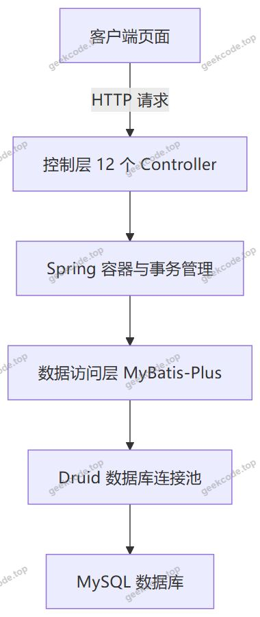
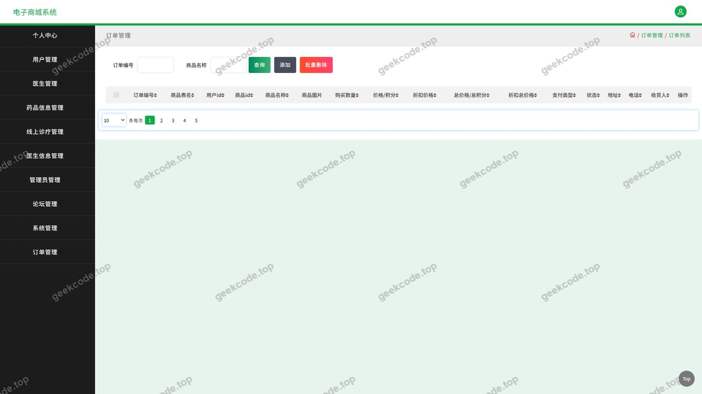
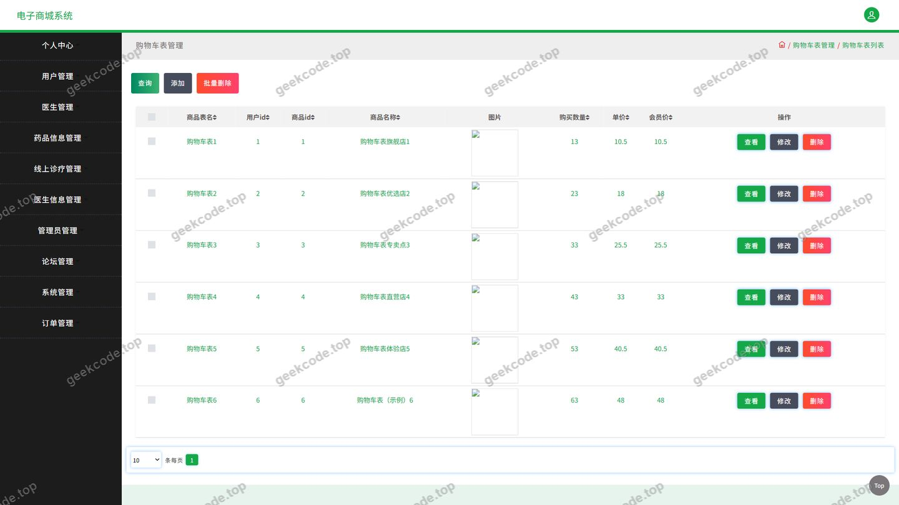
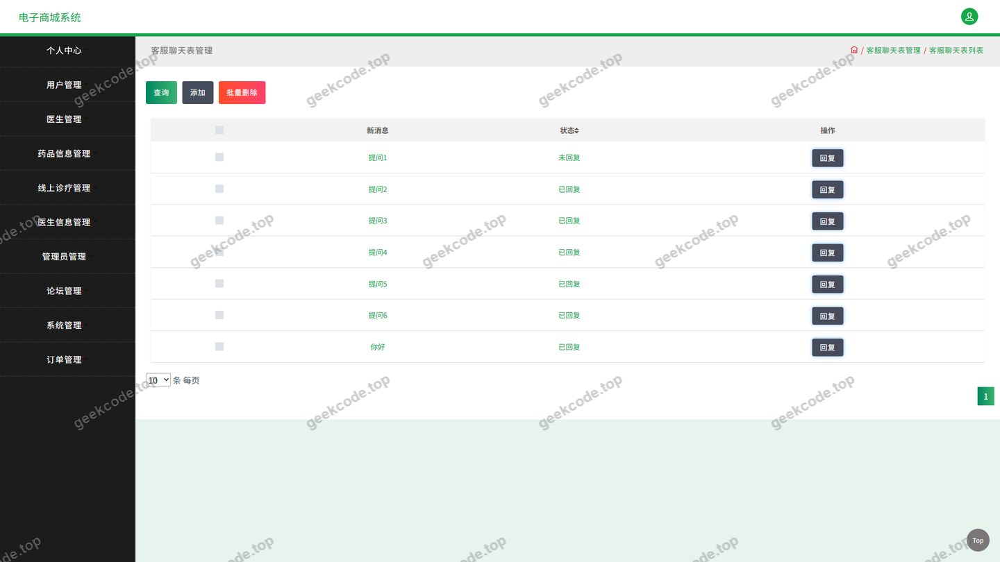
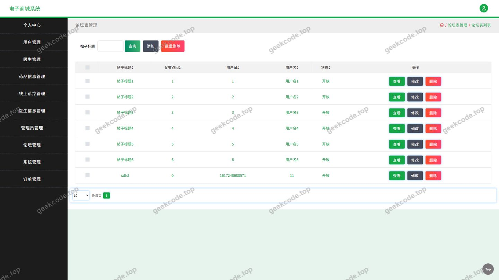
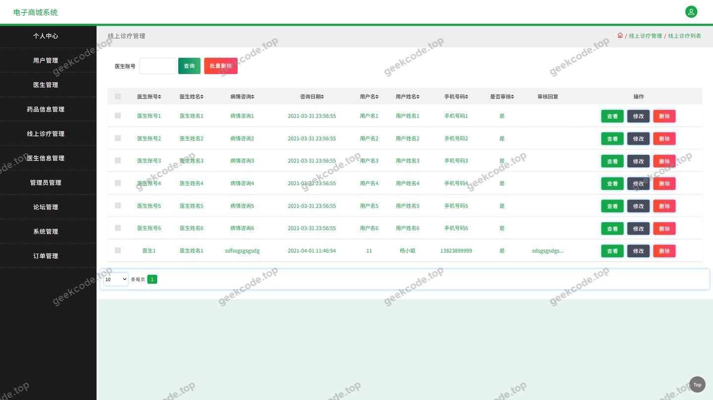
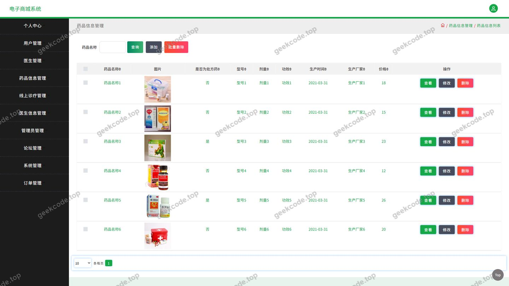
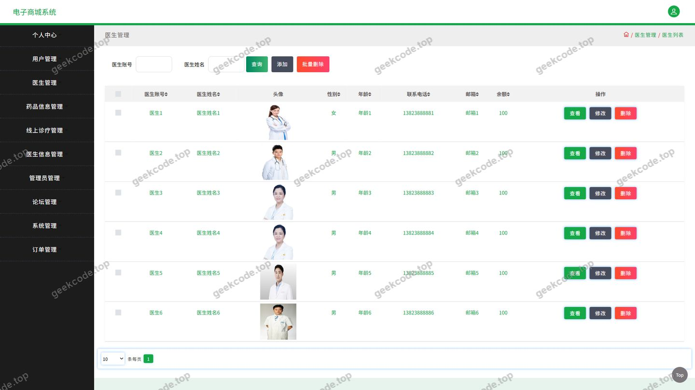
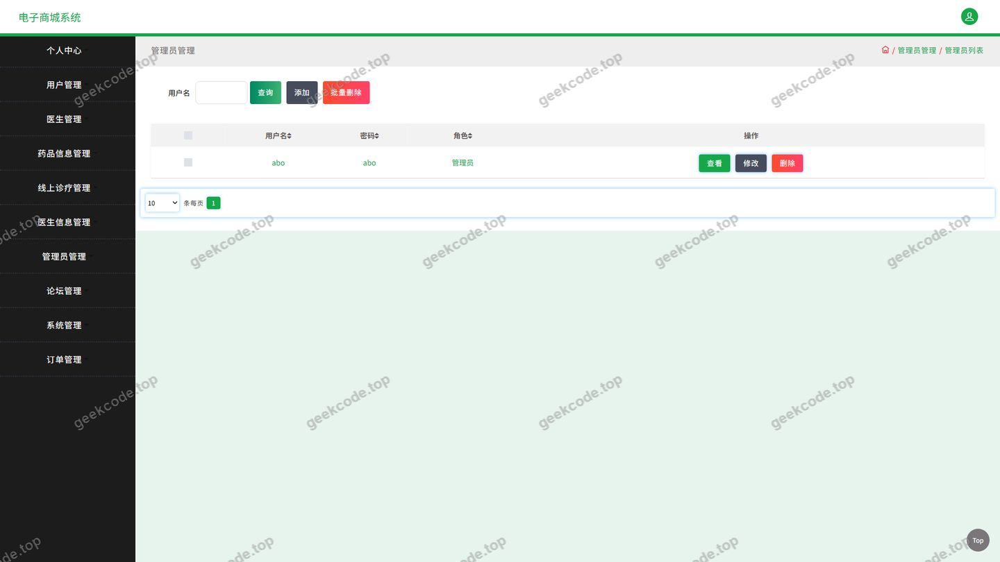

# ssm电子商城系统-java毕业设计

> 🎓 **计算机毕业设计 · ssm电子商城系统-java毕业设计**
>
> 本仓库只放**项目介绍 + 运行截图**（截图是站点带水印的原图，存在仓库 `images/` 里）。
>
> 👉 **完整可运行源码 / 数据库脚本 / 部署文档：[点我获取](https://geekcode.top/archives/ssm%E7%94%B5%E5%AD%90%E5%95%86%E5%9F%8E%E7%B3%BB%E7%BB%9F-java%E6%AF%95%E4%B8%9A%E8%AE%BE%E8%AE%A1?utm_source=github)**
>
> 💬 咨询微信：**ir9372**　|　🌐 更多项目：[极客代码 geekcode.top](https://geekcode.top/?utm_source=github)
>
> 📌 项目详情页：<https://geekcode.top/archives/ssm%E7%94%B5%E5%AD%90%E5%95%86%E5%9F%8E%E7%B3%BB%E7%BB%9F-java%E6%AF%95%E4%B8%9A%E8%AE%BE%E8%AE%A1?utm_source=github>

<table><td width="230" align="center"> <b>扫码加微信 ir9372</b></td><td valign="middle">📦 源码 = 项目介绍 + 全部运行截图 + 数据库 + 部署文档 👉 点上方任意截图，直接跳到 <b>极客代码 geekcode.top</b> 详情页</td></table>

---

<h1>ssm电子商城系统-java毕业设计</h1>
<h2>项目概述</h2>

电子商城系统是一套面向医药电商与线上问诊场景的后端服务项目，采用 Spring + Spring MVC + MyBatis-Plus 的经典分层架构，通过 Druid 连接池访问关系型数据库，以纯接口（pure-api）形式对外提供数据服务。

系统围绕药品信息、医生信息、论坛信息三大入口构建业务闭环：用户可以浏览药品详情、查看医生资料、发起线上诊疗咨询，并可将药品加入购物车、下单购买、管理收货地址；同时通过论坛发布内容、通过客服聊天与平台沟通。个人中心提供个人中心、我的发布、我的订单、我的地址四类自助服务。

项目主要面向需要完成医药类电商系统设计的高校毕业生作为毕业设计参考实现，也适用于希望在 Spring 技术体系下学习分层架构、REST 接口设计与业务模块拆分的开发者。系统当前不包含独立的后台管理端页面。

<h2>技术架构</h2>
<h3>整体架构</h3>

项目采用前后端分离的接口服务模式，后端仅对外暴露 HTTP 接口，不负责视图渲染。整体数据流向如下：

<h3>后端分层</h3>

项目依赖覆盖 Spring 完整技术栈，各组件职责如下：

<table>
<thead>
<tr>
<th>依赖</th>
<th>在项目中的作用</th>
</tr>
</thead>
<tbody><tr>
<td>spring-core、spring-beans、spring-context、spring-context-support</td>
<td>容器与 Bean 管理，依赖注入</td>
</tr>
<tr>
<td>spring-web、spring-webmvc</td>
<td>请求映射、参数绑定、接口响应</td>
</tr>
<tr>
<td>spring-tx</td>
<td>声明式事务管理</td>
</tr>
<tr>
<td>spring-aop</td>
<td>面向切面编程，用于事务与通用逻辑织入</td>
</tr>
<tr>
<td>spring-jdbc</td>
<td>JDBC 基础能力支撑，配合连接池使用</td>
</tr>
<tr>
<td>MyBatis-Plus</td>
<td>数据访问层，简化单表增删改查与条件构造</td>
</tr>
<tr>
<td>Druid</td>
<td>数据库连接池，负责连接复用与资源管理</td>
</tr>
<tr>
<td>junit</td>
<td>单元测试</td>
</tr>
</tbody></table>

控制层由 12 个控制器组成：AddressController、CartController、ChatController、CommonController、ConfigController、FileController、ForumController、OrdersController、UserController、XianshangzhenliaoController、YaopinxinxiController、YishengController，分别对应地址、购物车、客服聊天、公共数据、系统配置、文件、论坛、订单、用户、线上诊疗、药品信息、医生信息等业务域。

<h3>数据库设计要点</h3>

现有上下文未提供具体的表结构与字段定义，根据控制器与页面功能可归纳出系统需要承载的业务实体范围：

<ul>
<li>用户及其登录凭证、个人资料；</li>
<li>药品信息、医生信息两类核心资源数据；</li>
<li>线上下诊疗记录、客服聊天消息；</li>
<li>论坛帖子及其互动内容；</li>
<li>购物车条目、订单主记录与订单明细；</li>
<li>用户收货地址；</li>
<li>系统配置项与文件资源记录。</li>
</ul>

数据库设计建议以用户为中心组织外键关联，订单与购物车引用药品信息，论坛与聊天记录引用用户，保证业务数据可追溯。具体的字段类型、索引与约束策略需结合实际建表脚本确定。

<h3>核心技术选型理由</h3>
<ul>
<li><strong>Spring 全家桶</strong>：通过 IoC 与 AOP 统一管理对象生命周期与横切逻辑，降低模块间耦合，便于后续扩展新的业务控制器。</li>
<li><strong>MyBatis-Plus</strong>：在保留 SQL 可控性的同时提供通用 CRUD 能力，减少药品信息、医生信息、论坛等大量列表查询场景的重复代码。</li>
<li><strong>Druid</strong>：提供稳定的连接池能力，在高并发接口访问下控制数据库连接数量，避免连接泄漏。</li>
<li><strong>纯接口形态</strong>：后端只提供数据接口，前端可由 Web、移动端等多种终端复用，便于毕业设计中对接口层与展示层分别论证。</li>
</ul>
<h2>功能模块</h2>
<h3>用户端功能模块</h3>

系统以首页三大导航入口（药品信息、医生信息、论坛信息）与个人中心四大菜单（个人中心、我的发布、我的订单、我的地址）组织用户端功能。

<table>
<thead>
<tr>
<th>模块</th>
<th>对应控制器</th>
<th>功能描述</th>
</tr>
</thead>
<tbody><tr>
<td>登录与用户管理</td>
<td>UserController</td>
<td>用户注册、登录鉴权、个人资料维护，是个人中心、订单、发布等功能的身份基础。</td>
</tr>
<tr>
<td>药品信息</td>
<td>YaopinxinxiController</td>
<td>药品信息列表展示与详情查询，是商城主业务流程的核心数据来源。</td>
</tr>
<tr>
<td>医生信息</td>
<td>YishengController</td>
<td>医生资料展示与查询，为线上诊疗提供接诊医生资源。</td>
</tr>
<tr>
<td>线上诊疗</td>
<td>XianshangzhenliaoController</td>
<td>用户发起并管理线上诊疗记录，与医生信息模块联动。</td>
</tr>
<tr>
<td>论坛</td>
<td>ForumController</td>
<td>论坛帖子的发布、浏览与互动，&quot;我的发布&quot;菜单对应于此模块的用户侧数据。</td>
</tr>
<tr>
<td>购物车</td>
<td>CartController</td>
<td>将药品加入购物车、修改数量、删除条目，是下单前的临时数据容器。</td>
</tr>
<tr>
<td>订单</td>
<td>OrdersController</td>
<td>订单生成与查询，&quot;我的订单&quot;菜单对应用户的历史订单列表与状态查看。</td>
</tr>
<tr>
<td>地址管理</td>
<td>AddressController</td>
<td>收货地址的新增、修改、删除与选择，&quot;我的地址&quot;菜单对应此模块。</td>
</tr>
<tr>
<td>客服聊天</td>
<td>ChatController</td>
<td>用户与平台之间的在线消息沟通。</td>
</tr>
<tr>
<td>公共数据</td>
<td>CommonController</td>
<td>为各页面提供通用性的公共数据接口。</td>
</tr>
<tr>
<td>系统配置</td>
<td>ConfigController</td>
<td>维护系统运行所需的配置项。</td>
</tr>
<tr>
<td>文件管理</td>
<td>FileController</td>
<td>处理文件上传下载等资源操作，服务于头像、论坛图片等场景。</td>
</tr>
</tbody></table>
<h3>后台管理端功能模块</h3>

项目的后台路由为空，未提供独立的后台管理端页面与路由配置。因此系统当前不具备可视化的后台管理功能模块，药品信息、医生信息、论坛、订单等数据的维护能力需要通过既有接口或直接操作数据库实现。是否存在面向管理员的接口权限区分，根据现有信息无法确定。

<h2>用户角色与权限</h2>
<h3>未登录访客</h3>
<ul>
<li>访问药品信息模块，浏览药品列表与详情；</li>
<li>访问医生信息模块，浏览医生资料；</li>
<li>访问论坛信息模块，浏览论坛帖子内容；</li>
<li>访问登录页面完成账号登录。</li>
</ul>
<h3>已登录用户</h3>

在访客权限基础上，已登录用户额外拥有以下功能模块的访问权限：

<ul>
<li><strong>个人中心</strong>：查看与维护个人资料；</li>
<li><strong>我的发布</strong>：管理自己在论坛发布的帖子内容；</li>
<li><strong>我的订单</strong>：查看订单记录与订单状态；</li>
<li><strong>我的地址</strong>：新增、修改、删除收货地址；</li>
<li><strong>购物车</strong>：加入药品、调整数量、删除条目；</li>
<li><strong>线上诊疗</strong>：发起线上诊疗并查看诊疗记录；</li>
<li><strong>客服聊天</strong>：与平台客服进行在线沟通；</li>
<li><strong>文件管理</strong>：上传与获取与自身业务相关的文件资源。</li>
</ul>
<h3>管理员角色</h3>

项目未配置后台路由，也未在现有上下文与截图中出现管理员专属页面。系统是否存在独立的管理员角色及其权限范围，根据现有信息无法确定。

<h2>项目特色与创新点</h2>
<ol>
<li>
<strong>医药电商与线上问诊的业务融合</strong>。系统并非通用商品商城，而是将药品信息、医生信息与线上诊疗三个模块打通，用户在浏览药品的同时可以直接对接医生资源，形成&quot;选药—问诊—下单&quot;的连贯链路，贴合医药行业的实际使用逻辑。

</li>
<li>
<strong>社区论坛与交易流程并存</strong>。论坛信息作为一级导航入口，与商城、诊疗功能并列，用户既可以在论坛发布内容、沉淀健康话题，又能通过个人中心的&quot;我的发布&quot;集中管理自己的创作，提升了用户粘性与内容自生产的能力。

</li>
<li>
<strong>纯接口架构便于多端复用</strong>。项目以 pure-api 形态提供后端服务，控制层不承担视图渲染职责，药品、医生、订单、论坛等业务能力可被 Web 页面、移动应用等多种终端同时调用，接口边界清晰。

</li>
<li>
<strong>分层职责明确，便于二次开发</strong>。12 个控制器按业务域一一对应，配合 Spring 的 IoC、AOP 与事务管理以及 MyBatis-Plus 的数据访问能力，新增业务模块时只需按同样分层方式扩展，降低了毕业设计后续迭代与功能扩展的成本。

</li>
<li>
<strong>连接池保障数据访问稳定性</strong>。引入 Druid 作为连接池组件，统一管理数据库连接，避免订单、购物车等高频繁读写场景下出现连接资源耗尽问题，为接口的稳定响应提供基础支撑。

</li>
</ol>
<h2>部署环境</h2>
<h3>运行环境要求</h3>
<table>
<thead>
<tr>
<th>类别</th>
<th>要求</th>
</tr>
</thead>
<tbody><tr>
<td>Java 运行环境</td>
<td>需安装 JDK 以运行基于 Spring 的后端服务，具体版本根据现有信息无法确定</td>
</tr>
<tr>
<td>数据库</td>
<td>MySQL，用于存储用户、药品、医生、订单、论坛、聊天等业务数据</td>
</tr>
<tr>
<td>数据库连接池</td>
<td>Druid，随项目依赖引入并在配置中完成数据源配置</td>
</tr>
<tr>
<td>数据访问框架</td>
<td>MyBatis-Plus，与 Druid 配合完成数据库操作</td>
</tr>
<tr>
<td>测试框架</td>
<td>junit，用于编写与执行单元测试</td>
</tr>
</tbody></table>
<h3>启动步骤</h3>
<ol>
<li>安装并启动 MySQL 服务，创建项目所需数据库；</li>
<li>导入项目提供的建表脚本与基础数据；</li>
<li>在项目数据源配置中填写数据库连接地址、用户名、密码，并配置 Druid 连接池参数；</li>
<li>部署后端服务，由 Spring 容器加载各控制器与 MyBatis-Plus 的 Mapper 组件；</li>
<li>通过接口调试工具或前端页面访问药品信息、医生信息、论坛信息等模块，验证服务可用性。</li>
</ol>

前端页面的运行环境要求（如 Node.js、构建工具版本等）在现有上下文中未提供，根据现有信息无法确定。

<h2>五、技术特性</h2>
<ul>
<li>使用 MyBatis-Plus 简化数据访问层开发</li>
</ul>
<h2>六、功能模块截图</h2>
<h3>后台管理端</h3>
<h4>页面-登录</h4>

<h4>页面-订单</h4>

<h4>页面-购物车</h4>

<h4>页面-客服聊天</h4>

<h4>页面-论坛</h4>

<h4>页面-线上诊疗</h4>

<h4>页面-药品信息</h4>

<h4>页面-医生</h4>

<h4>页面-用户</h4>

---

## 获取完整源码

| 项目 | 说明 |
| --- | --- |
| 项目名 | ssm电子商城系统-java毕业设计 |
| 运行截图 | 本文 10 张（站点带水印原图，仓库 `images/` 目录） |
| 完整源码 | [https://geekcode.top/archives/ssm%E7%94%B5%E5%AD%90%E5%95%86%E5%9F%8E%E7%B3%BB%E7%BB%9F-java%E6%AF%95%E4%B8%9A%E8%AE%BE%E8%AE%A1?utm_source=github](https://geekcode.top/archives/ssm%E7%94%B5%E5%AD%90%E5%95%86%E5%9F%8E%E7%B3%BB%E7%BB%9F-java%E6%AF%95%E4%B8%9A%E8%AE%BE%E8%AE%A1?utm_source=github) |
| 咨询微信 | **ir9372**（备注：jingpin-yuanma） |
| 更多项目 | [极客代码 geekcode.top](https://geekcode.top/?utm_source=github) |

> 需要源码、部署、改配置、跑不起来等问题，加微信 ir9372 沟通，说明项目名即可。
